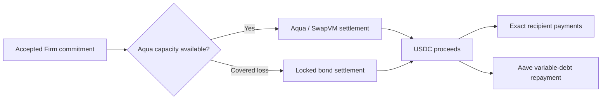

# FirmDepth

**Collateral-backed commitments and atomic settlement for 1inch Aqua.**

FirmDepth lets a treasury commit WETH to a maker-signed USDC quote, then use the proceeds to pay recipients or repay Aave V3 debt. If shared Aqua inventory disappears after acceptance, an eligible commitment can settle from its locked bond. Distribution or repayment completes in the same execution transaction.

Built for **ETHGlobal Mumbai 2026 · 1inch Aqua Continuity**. This work extends the existing FirmDepth implementation and builds on Aqua, SwapVM and Aave's established functionality.

[Run locally](#run-locally) · [Application walkthrough](docs/local-user-flow.md) · [Architecture](docs/firmdepth-core.md) · [Deployment](#deployment-and-evidence)

## Why FirmDepth exists

Aqua lets a maker reuse wallet inventory across strategies. A quote can therefore look executable and later lose capacity when another strategy consumes that inventory.

FirmDepth keeps the trading inventory reusable and locks separate USDC collateral when a trader accepts a Firm commitment. Protection covers defined post-acceptance capacity loss. Unrelated failures revert execution rather than spending the bond.

## What is implemented

| Layer | Responsibility |
|---|---|
| **Original FirmDepth** | Signed quotes, premium pricing, commitment acceptance, collateral locks, Aqua/SwapVM execution, covered bond settlement, expiry and replay protection. |
| **Protected Settlement** | Immutable payer-owned payout plans, isolated WETH funding, exact recipient allocations, atomic transfers, surplus and expiry refunds. |
| **Protected Debt Repayment** | A fixed Aave V3 repayment action around Protected Settlement, with an authorized borrower, repayment limits, bounded approval and verified debt reduction. |

The maker signs **Protected Settlement as taker**. The connected wallet remains the payer; the debt adapter records that payer separately from the underlying contract-owned payout plan.

## How settlement works

1. **Create a plan:** fix the recipients and allocations, or the borrower and repayment limits.
2. **Fund it:** deposit the WETH principal and maximum premium budget.
3. **Inspect a quote:** check its signed USDC minimum, premium, collateral and expiry.
4. **Accept:** a separate transaction binds the commitment and locks collateral.
5. **Execute:** FirmDepth supplies USDC and completes the authorized payouts or repayment atomically.
6. **Verify:** the SDK reconciles receipts, transfers and terminal state. Unused funds return to the authorized payer.



An unrelated swap, token, payout or repayment failure reverts the execution transaction. Acceptance remains a separate transaction, with its existing premium and expiry rules.

## Run locally

Use **Node.js 24 LTS**, npm, Bash, `curl`, and Chrome. The browser runner defaults to `/usr/bin/google-chrome-stable`; set `PLAYWRIGHT_CHROME_PATH` if needed. A Base archive RPC must support block **51,123,118**.

```bash
git clone https://github.com/Kevincruz2005/FirmDepth.git
cd FirmDepth

# Preserve an existing environment file.
test -f .env || cp .env.example .env

# Optional: set BASE_RPC_URL in .env to a reliable archive provider.
set -a
source .env
set +a

KEEP_LOCAL_FORK=1 ./scripts/demo_protected_debt.sh
```

The runner installs missing dependencies, builds the application, runs regression suites, deploys a fresh fork fixture and verifies real ERC-20/Aave transactions. Allow several minutes. Keep the terminal open after the success message to retain the node.

In a second terminal, from the repository root:

```bash
unset VITE_FIRMDEPTH_API_URL
npm --prefix packages/frontend run dev
```

Open **[localhost:4173/settlement](http://127.0.0.1:4173/settlement)** and choose **Payout** or **Debt Repayment**. RPC: `http://127.0.0.1:8545`, chain ID `8453`. The retained fixture includes a funded test payer and an actual 600-USDC Aave debt position.

The [local user-flow guide](docs/local-user-flow.md) explains wallet setup, every button, sibling liquidity depletion, partial repayment, refunds and receipts. Production wallet keys are not needed. The Base RPC supplies snapshot data; transactions execute on the fork.

## Deployment and evidence

| Environment | Application | Scope |
|---|---|---|
| **Public Sepolia** | [Protected payouts](https://firmdepthpkg3207de.z29.web.core.windows.net/settlement) | Real public-testnet payouts; existing deployment preserved. |
| **Azure-hosted Base fork** | [Payout and repayment demo](https://firmdepth-debt-3207de.azurewebsites.net/settlement) | Isolated hosted fork with real Aqua, Aave and ERC-20 contracts. Check [health](https://firmdepth-debt-3207de.azurewebsites.net/health) before a demo. |
| **Local Base fork** | `http://127.0.0.1:4173` | Full lifecycle, adversarial scenarios and local development. |

Forks and Base mainnet share chain ID `8453`. Use the intended fork RPC. The repayment UI also checks adapter bytecode and a reference block hash before submitting transactions.

The existing Sepolia USDC is **not** an Aave variable-debt reserve. Repayment therefore uses the compatible Base market on a fork; no public Sepolia repayment is claimed. See the [compatibility evidence](deployments/aave-sepolia-compatibility.json).

Evidence is separated by environment:

- [Public Sepolia contracts](deployments/sepolia.json), [payout wrapper](deployments/protected-sepolia.json) and [public payout receipts](packages/contracts/evidence/protected-settlement-sepolia.json).
- [Local protected payouts](deployments/protected-base-fork.json) and [local Aave repayment deployment](deployments/protected-debt-base-fork.json).
- [Azure fork deployment](deployments/azure-protected-debt.json) and [verified Azure repayment receipts](packages/contracts/evidence/protected-debt-azure-fork.json).
- [Public Sepolia/Azure runbook](docs/azure-deployment.md) and [separate Azure fork deployment guide](docs/azure-debt-demo.md).

`LIVE` identifies the connected environment. Recorded fork transactions, synthetic benchmarks and illustrative values have distinct labels. Fork hashes are verified against their fork node; they are not public Base explorer transactions. A fork restart creates a new generation and requires fresh evidence.

## Verification

| Suite | Passing tests |
|---|---:|
| Solidity: FirmDepth, Protected Settlement and repayment | 121 |
| SDK | 39 |
| Quote service | 12 |
| Frontend unit tests | 35 |
| Benchmark regressions | 8 |
| Original fork/browser regressions | 25 |
| Protected payout browser scenarios | 3 |
| Local Aave browser scenarios | 5 |
| Hosted gateway security policy | 6 |
| Azure-hosted browser scenarios | 3 |

Builds and type checks pass. Frontend lint has zero errors and one existing payout-effect dependency warning. Public Sepolia browser checks are a separate gate; historical-receipt availability and RPC rate limits remain documented in the public deployment runbook.

```bash
# Original backend verification
./scripts/demo_backend.sh

# Payout-only local demonstration
./scripts/demo_protected_settlement.sh

# Complete local payout and Aave demonstration
KEEP_LOCAL_FORK=1 ./scripts/demo_protected_debt.sh

# Hosted gateway security checks
node --test infra/azure/fork/policy.test.mjs
```

## Repository map

| Path | Contents |
|---|---|
| [`packages/contracts`](packages/contracts/) | Contracts, deployment scripts and Solidity tests. |
| [`packages/sdk`](packages/sdk/) | Quotes, actions, authentication and receipt verification. |
| [`packages/quote-service`](packages/quote-service/) | Allowlisted public quote service and boundary tests. |
| [`packages/frontend`](packages/frontend/) | Trade, settlement, maker controls, evidence views and browser tests. |
| [`packages/benchmark`](packages/benchmark/) | Reproducible synthetic stress benchmarks. |
| [`deployments`](deployments/) | Addresses, compatibility checks and deployment manifests. |
| [`infra/azure`](infra/azure/) | Public Sepolia hosting and isolated hosted-fork infrastructure. |

## Security and scope

Plans bind their payer, amounts, downstream destination and deadline. Repayment also binds the borrower, chain, Aave Pool, asset, debt mode and commitment. Execution is isolated per plan, non-reentrant and one-time. Approvals are bounded and transfers must reconcile exactly.

The supported path is exact-input WETH to exact-transfer USDC. Reserve pauses, token restrictions, governance changes, debt changes and expiry can prevent repayment. There is no unconditional repayment or liquidation-prevention guarantee. The extension has not received an independent production audit.

Read the [core security model](docs/firmdepth-core.md), [payout assumptions](docs/protected-settlement.md) and [repayment accounting and limitations](docs/protected-debt-repayment.md) before changing deployment policy.

## Mumbai Continuity attribution

Original FirmDepth baseline: `89c4a7910f054042872927a29e162538f6fa7b65`. Protected Settlement was complete at `2d823188e981ea44f97dd6421fe2c1638ea8d027`, before the Aave extension.

Aqua/SwapVM integration, `FIRM_PRICE`, `FIRM_GUARD`, quote signatures, premiums and bond guarantees predate the downstream extensions. Mumbai additions compose those mechanisms into payouts and Aave's existing repayment operation. The [changelog](docs/mumbai-changelog.md) records the incremental work.

Pinned sources: [Aqua](https://github.com/1inch/aqua) `9c5c42e5840e8741fba3597c48456c9510212b66`, [SwapVM](https://github.com/1inch/swap-vm) `f09a41e689240adc645934f965c8061749397cd2`, `@1inch/aqua-sdk` 0.3.2 and `@1inch/solidity-utils` 6.9.10. Solidity 0.8.30, optimization and IR compilation are enabled.

## Licensing

Powered by Aqua — © Degensoft Ltd 2025<br>
Powered by SwapVM — © Degensoft Ltd 2025

SwapVM-linked contracts use `LicenseRef-Degensoft-SwapVM-1.1`; the unmodified Aqua deployment wrapper uses `LicenseRef-Degensoft-Aqua-Source-1.1`. Full texts are in [`LICENSES`](LICENSES/).
