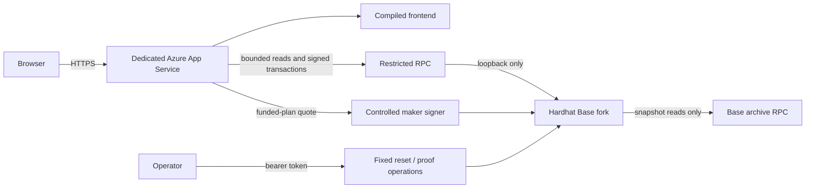

# Azure-hosted Aave repayment demonstration

This is a separate controlled Base fork hosted on Azure. It does not broadcast transactions to Base mainnet and does not change the existing public Sepolia API, storage website, contracts or tokens. The archive RPC supplies the fork snapshot at block 51,123,118. Real Aqua, Aave Pool, debt-token, USDC and WETH bytecode executes on the hosted fork.

## Hosting boundary

The dedicated Linux B1 plan and Node 24 App Service run one fork process bound to loopback, a restricted HTTP gateway and the compiled frontend. The gateway exposes HTTPS using the App Service hostname. The tested artifacts and a locked minimal dependency installation are packaged locally; no Solidity compilation or production-chain signing keys are needed on the host.



Public RPC excludes `eth_sendTransaction`, accounts, signing, debug, impersonation, balance/code changes and time controls. Signed transactions must use chain 8453 and a known application/reserve target. Development accounts are additionally blocked from public signed submission; operator wallet submission is restricted to the controlled trader and drainer. Public requests have body, concurrency, quote-rate and log-range bounds. Upstream errors cannot expose private RPC URLs. The archive is built from an explicit allowlist and excludes `.env`, logs, local fork state and previously recorded receipts.

The operator token is generated in `.azure-package/debt-operator.env` with permissions 0600, then uploaded through a temporary JSON settings file without putting its value in command arguments. Azure stores it in the dedicated app's settings. It never enters Git, the browser bundle, public runtime or evidence. The app has no access grant to the existing Sepolia Key Vault. Treat operator browser traces as private: they may contain the authorization header and remain ignored.

## Deploy

From the repository root, authenticate Azure CLI and run:

```bash
./infra/azure/deploy-fork.sh
```

Optional `FORK_AZURE_*` names are in `.env.example`. The script refuses the existing production resource group/app name. `BASE_RPC_URL` may provide a reliable archive endpoint; otherwise the same public Base endpoint used by the local demonstration is selected. Only the new resource group, plan and app are provisioned. No production maker or Sepolia deployer key is required.

Wait for `/health` to report `phase: ready`, then trigger the fixed proof operation using a local environment variable, never a token pasted into source or a command argument:

```bash
set -a
source .azure-package/debt-operator.env
set +a
export FORK_DEMO_URL='https://the-created-app.azurewebsites.net'
python3 - <<'PY'
import os,json,urllib.request
url=os.environ['FORK_DEMO_URL']+'/operator/prove'
request=urllib.request.Request(url,data=b'{}',headers={
    'Content-Type':'application/json',
    'Authorization':'Bearer '+os.environ['FORK_OPERATOR_TOKEN']})
print(urllib.request.urlopen(request).read().decode())
PY
```

The operation creates actual WETH collateral and 600 USDC of debt, executes Aqua and covered-bond repayments, verifies a smaller debt close and surplus, checks expiry and a mined rollback after reaching the real Pool, then leaves a fresh interactive position. The existing demo and independent verifier scripts run unchanged. Operator operations serialize and quote/transaction endpoints stop during fixture preparation to prevent use of changing runtime addresses.

After `/health` reports both `phase: ready` and `proofReady: true`, independently verify and optionally record the hosted evidence:

```bash
RECORD_HOSTED_EVIDENCE=1 node scripts/verify_hosted_debt.mjs
FIRMDEPTH_HOSTED_E2E=1 FIRMDEPTH_E2E_BASE_URL="$FORK_DEMO_URL" \
  npm --prefix packages/frontend run test:browser -- --workers=1 hosted-debt
```

The browser suite resets positions and sends real hosted-fork transactions through an authenticated test wallet. After those tests, run `/operator/prove` again to leave the complete proof plus a fresh interactive fixture. The browser wallet fixture is test tooling; the public site does not receive its operator token. Normal users can connect a wallet configured with the hosted `/rpc` endpoint; the default borrower display is the actual controlled position. The payer authorization and balances still determine which actions are possible.

Public `/demo/deployment` and `/demo/evidence` contain verified addresses, transaction hashes, balances and the current fork generation. `scripts/verify_hosted_debt.mjs` checks code hashes, repayment receipts, historical failure/expiry state, current frontend identity and operator access restrictions using the public RPC. It deliberately does not expose the EVM debug endpoint; the internal independent verifier checks the rollback trace before publication.

## Evidence and operations

The public labels say **LIVE AZURE FORK**. Local and Azure forks have separate state and receipts. Hosted evidence is recorded separately in `deployments/azure-protected-debt.json` and `packages/contracts/evidence/protected-debt-azure-fork.json`; original local and Sepolia records remain intact. The proof deployment and fresh interactive deployment are separately identified in the manifest.

The fork chain is volatile. A process restart creates a new generation, redeploys contracts and initially has no published proof; rerun the proof before a judge session. Always On reduces idle shutdowns but is not persistent-chain storage. Archive rate limits can prevent a cold start. Keep the deployment single-instance; independent fork processes cannot share one live RPC identity.

This is a shared controlled demonstration, not a public production chain or a liquidation guarantee. Aave availability, token restrictions and changing debt can prevent execution. The fixed 2,000-USDC/WETH fixture quote is labelled test pricing. Transactions on this fork do not appear on public Base explorers. Base mainnet also uses chain 8453: the repayment UI checks adapter bytecode and a reference block hash before submitting.

The dedicated B1 plan incurs charges while allocated. Deleting `firmdepth-debt-demo-rg` removes this isolated demonstration and its plan; it does not remove `firmdepth-mumbai-rg` or the public Sepolia deployment.
