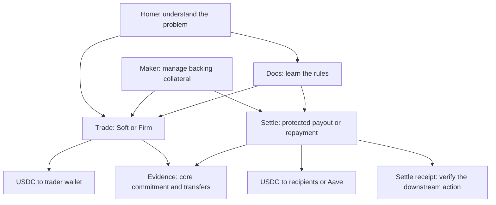

# Local application walkthrough

This guide explains how to run FirmDepth locally, what each action does, and how to verify its result. Start with the normal path, then try the liquidity-drain and refund scenarios from a fresh fixture.

The application uses actual Aqua, SwapVM, Aave and ERC-20 contracts on a **local Base fork**. The archive RPC supplies the starting state. Your transactions stay on the local node.

Read the [complete product journey](#the-complete-product-journey) first, then jump to [local setup](#1-start-the-application), [the core trade workflow](#the-core-workflow-maker--trade--evidence), [payouts](#4-pay-two-recipients-through-aqua), [Aave repayment](#5-repay-aave-debt-through-aqua), or [bond fallback](#6-demonstrate-covered-bond-settlement).

## The complete product journey

FirmDepth's core product is a **protected WETH-to-USDC trade**. The maker signs a minimum output, the trader accepts it, and separate bond collateral backs the accepted obligation. Protected payouts and Aave repayment use that same engine to put the USDC proceeds to work immediately.

There are three roles:

| Role | What they contribute | Where they act |
|---|---|---|
| Maker | Aqua trading inventory, USDC bond collateral and signed quotes. | Configured strategy/signing service; **Maker** page manages its bond. |
| Trader / payer | WETH principal and the accepted premium; chooses the intended outcome. | **Trade** for wallet receipt, or **Settle** for payouts/repayment. |
| Verifier / judge | Checks what actually happened against contract state and transfers. | **Evidence**, settlement receipts and environment-specific evidence files. |

The current application uses one configured maker. The Maker page does not onboard arbitrary wallets or create new Aqua strategies. Setup scripts initialize inventory/strategies; the quote service supplies signatures. A connected payer cannot manage the maker's collateral.

### How all six pages connect

| Page | Its job | What you do | Connection to the rest |
|---|---|---|---|
| **Home** `/` | Explain the product's reason to exist. | Understand reusable inventory, Soft versus Firm and the three depth measurements. | Leads to Trade and Evidence. It does not move funds. |
| **Maker** `/maker` | Show and manage the capital backing Firm commitments. | Inspect inventory, available/locked bond, utilization, outcomes and premiums. The configured maker can Deposit or Withdraw available bond. | Acceptance in Trade or Settle locks this bond; execution or expiry changes the same balances and history. |
| **Trade** `/trade` | Execute the original core product. | Choose Soft or Firm, inspect depth and quote, then trade. Firm acceptance and execution are separate steps. | Uses the configured maker's strategy/signature and bond. Sends USDC to the trader. Its commitment can be checked in Evidence. |
| **Settle** `/settlement` | Use protected proceeds for an authorized downstream purpose. | Create/fund a payout or debt plan, inspect a quote, accept and execute atomically. | Calls the same FirmDepth core as Trade, with the settlement wrapper as taker. Pays recipients or Aave instead of requiring a later manual transfer. |
| **Evidence** `/evidence` | Verify core execution and explain its provenance. | Read current inventory/bond/history, inspect recorded public/fork proof, or decode a core receipt using its three hashes. | Reads the same registry, router and vault. Detailed recipient and Aave verification remains in the Settle receipt view and associated evidence files. |
| **Docs** `/docs` | Explain mechanics and operating rules. | Read lifecycle, depth definitions, premiums, bond behavior, security boundaries and existing deployment details. | Helps interpret every other page; it does not authorize or execute transactions. Repository guides cover the newer payout/Aave flows in more detail. |



All pages share the authenticated runtime: network, RPC, deployed contracts, configured strategies and connected wallet. Their financial connection is the onchain commitment and its collateral lock. Navigation does not itself move tokens or create a commitment. Reopen/refresh a page to inspect the resulting chain state.

### Four ways to use the execution engine

| Entry point | Protection | Where the WETH principal stays before execution | USDC destination |
|---|---|---|---|
| Trade → Soft | No Firm premium or dedicated bond lock. | Trader wallet. | Trader wallet. |
| Trade → Firm | Maker-signed commitment with a dedicated bond lock after acceptance. | Trader wallet; acceptance escrows the premium separately. | Trader wallet. |
| Settle → Payout | The same Firm protection plus immutable recipient allocations. | Funded plan escrow. | Predetermined recipients; surplus to payer. |
| Settle → Debt Repayment | The same Firm protection plus a fixed, verified Aave action. | Funded plan escrow through the repayment adapter/wrapper. | Aave reserve; permitted surplus to payer. |

**Choose Trade or Settle according to the desired result.** You do not first execute Trade and then send those proceeds into a settlement plan. Settle funds its own WETH commitment so the swap and downstream action can succeed or revert together.

For a direct Firm trade, the signed taker is the connected trader wallet. For both Settle modes, it is Protected Settlement. The repayment adapter and original payer have distinct roles; connecting a wallet does not replace the signed taker or configured maker.

### The core workflow: Maker → Trade → Evidence

1. **Inspect Maker.** Confirm the configured maker has Aqua inventory and available USDC bond. Only connect that maker wallet when managing its collateral. Deposit first approves USDC, then deposits it. Withdraw can use only available collateral, never an accepted commitment's lock.
2. **Open Trade and connect the funded trader.** Enter the WETH amount. The Depth reality panel separates Virtual depth, Pullable depth and quote-scoped Firm depth. Large advertised inventory does not automatically mean an executable or collateral-backed quote.
3. **Try Soft on a fresh fixture.** Select Soft, inspect its current SwapVM quote and choose **Execute Soft swap**. Approve WETH if requested. This is a direct Aqua execution attempt with no protected commitment or premium.
4. **Use a fresh fixture to try Firm.** Select Firm and choose a 120-second horizon for a manual demonstration. Fork mode requests its signed quote automatically; the public deployment also exposes **Request fresh Firm quote**. Check the output minimum, premium, expiry and eligibility.
5. **Select Accept Firm quote.** Confirm any necessary approvals and acceptance. The app refreshes the quote after approval when needed. Acceptance creates the commitment, escrows its premium and locks the maker's bond; it does not yet execute the principal swap.
6. **Use the Latest Firm commitment card.** Check its commitment ID, lock and expiry, then select **Execute**. It receives USDC through Aqua when capacity remains sufficient or through the covered bond path after an eligible capacity loss. If the deadline has passed, **Settle expiry** finalizes expiry instead. For this direct trade, unspent principal remains in the trader wallet.
7. **Inspect Maker again.** Available and locked collateral reflect the same commitment. The dashboard's outcomes and premium history show terminal events. These are chain reads, not a separate accounting system.
8. **Open Evidence.** Inspect current commitment history or supply the commitment ID, acceptance transaction hash and terminal transaction hash to **Decode from chain**. The SDK verifies the core result and token/bond movements.

Soft swaps have no Firm commitment ID. Their execution confirmation and swap receipt are different from the Firm commitment decoder; their effect on shared inventory is still visible in live depth reads.

Local fixture example: suppose the vault starts with 1,000 USDC and a quote promises 200 USDC with a 240-USDC collateral requirement.

| Point in the journey | Available bond | Locked bond | Total maker bond |
|---|---:|---:|---:|
| Before acceptance | 1,000 | 0 | 1,000 |
| After acceptance | 760 | 240 | 1,000 |
| After Aqua execution | 1,000 | 0 | 1,000 |
| After covered bond execution instead | 800 | 0 | 800 |
| After expiry instead | 1,000 | 0 | 1,000 |

The last three rows are alternative outcomes. Bond execution pays 200 USDC and releases the remaining 40 USDC of the lock. Aqua execution and expiry release the entire lock. The accepted premium is finalized once under the original rules.

### How the extensions fit

After understanding the direct Firm trade, use **Settle** for an application outcome. The payer fixes the destination first, funds escrow, then accepts a maker quote signed for Protected Settlement. Execution uses the same Aqua/bond decision and completes recipient payments or Aave repayment in that transaction. A downstream failure reverts the complete execution.

An accepted Settle commitment affects the same Maker bond metrics and underlying registry history. Its detailed proof is shown on the settlement page: recipient allocations for payouts, or actual Pool repayment and debt reduction for Aave. Evidence's core decoder alone is not a complete Aave debt-repayment verifier.

### What the current UI does not connect automatically

- Maker onboarding, creation of new Aqua strategies and multi-maker quote selection are not available in the current UI.
- Trade does not turn a completed wallet swap into an atomic payout or repayment afterward. Choose Settle before creating that commitment.
- Home/Docs still contain Sepolia-first wording from the original product. Check the authenticated runtime/environment before transacting; a page title does not change the connected chain.
- Evidence combines historical public proof, pinned fork proof and current-runtime reads. A fresh fixture may have no current commitments even though earlier recorded demonstrations exist. Use matching environment and contract addresses when decoding.
- The UI does not yet present one unified guided journey or one combined receipt view for every downstream action. The contracts, shared runtime and receipts provide the connection described above.

The step-by-step sections below cover the actual local setup and downstream flows.

## 1. Start the application

From the repository root, with Node 24 LTS, npm, Chrome, Bash and `curl` installed:

```bash
# Optional: load BASE_RPC_URL from an existing ignored environment file.
test -f .env || cp .env.example .env
set -a
source .env
set +a

KEEP_LOCAL_FORK=1 ./scripts/demo_protected_debt.sh
```

If `.env` does not exist, copy `.env.example` first. Only the Base archive RPC is relevant to this local run; production maker and Sepolia deployer keys are not required. The public Base RPC is the runner's default, but can rate-limit a cold start.

The runner builds and tests the project, deploys the contracts, verifies the demonstrations and leaves a fresh borrower position. Wait for the verification success message. Keep this terminal open so the fork remains running.

In a second terminal:

```bash
unset VITE_FIRMDEPTH_API_URL
npm --prefix packages/frontend run dev
```

| Item | Local value |
|---|---|
| Application | `http://127.0.0.1:4173` |
| Settlement page | `http://127.0.0.1:4173/settlement` |
| Wallet RPC | `http://127.0.0.1:8545` |
| Chain ID | `8453` |
| Starting fork block | `51,123,118` |
| Evidence label | `LIVE LOCAL FORK` |

If the app and node are already running in this workspace, you can use them directly. A clean runner refuses to overwrite a node already using port 8545. Starting the frontend alone does not create contracts, balances or an Aave position.

## 2. Connect the test payer

Configure your browser wallet to use the local RPC above, then select **Connect wallet** in the app. The interface supports injected browser wallets and provides a wallet chooser when more than one is installed.

The fixture uses these Hardhat development accounts:

| Role | Account | Purpose |
|---|---|---|
| Maker | `0x70997970C51812dc3A010C7d01b50e0d17dc79C8` | Supplies Aqua inventory and deposits USDC bond collateral. |
| Payer / borrower | `0x3C44CdDdB6a900fa2b585dd299e03d12FA4293BC` | Development account #2; funds plans and holds the Aave debt. |
| Sibling trader | `0x90F79bf6EB2c4f870365E785982E1f101E93b906` | Development account #3; performs the separate liquidity-drain swap. |

Use development account #2 for the main walkthrough. Import its development key locally from the node's account output/private diagnostic log. Do not use a production wallet key or send funds to these publicly known development accounts on a public network. The retained runner's node log is under `/tmp/firmdepth-debt-node.*`.

Base mainnet also uses chain ID 8453. The wallet must use **the local RPC**, not its usual Base RPC. The repayment page checks the adapter's bytecode and a reference block hash before sending a transaction.

The payer has fork WETH available, and the setup creates approximately 600 USDC of variable-rate Aave debt through an actual collateral supply and borrowing transaction. Interest can make the displayed debt slightly larger than 600.

Current addresses are in the ignored `packages/frontend/.runtime/firmdepth.json`. That file contains public deployment/account metadata, not wallet keys.

## 3. Understand the lifecycle

Open **Settle**. The page has two modes: **Payout** and **Debt Repayment**.

| State / action | What happens | What to check |
|---|---|---|
| Create | A transaction records an immutable plan. No principal is moved yet. | Destination, amounts, plan ID and deadline. |
| Approve and fund | An ERC-20 approval and a funding transaction move principal plus premium budget into isolated escrow. | The connected account is the intended payer. |
| Inspect quote | The service returns a genuine maker signature; this is not an acceptance transaction. | USDC minimum, premium, bond and expiry. |
| Accept | A separate transaction accepts the quote, reserves its premium and locks collateral. | State becomes `ACCEPTED`; record the commitment ID. |
| Execute | One transaction settles the swap and completes every downstream action. | `PAID` and a verified receipt. |
| Refund | The owner cancels before acceptance or recovers eligible escrow after commitment expiry. | `REFUNDED` and the payer's WETH balance. |

The default plan deadline is one hour. The inspected commitment normally lasts 120 seconds. Once accepted, execution must meet the **commitment expiry**, even if the plan's one-hour deadline is later.

After creation, the recipients or borrower cannot be edited. Cancel an unaccepted plan and create another if its details are wrong. Keep the same payer wallet connected. The page recovers the latest plan for that account and active deployment after a reload; keep plan IDs and hashes for older plans.

## 4. Pay two recipients through Aqua

Choose **Payout** and enter these test values:

| Field | Value |
|---|---|
| WETH principal | `0.1` |
| Maximum WETH premium | `0.002` |
| Recipient 1 | `0x15d34AAf54267DB7D7c367839AAf71A00a2C6A65` |
| USDC allocation 1 | `120` |
| Recipient 2 | `0x9965507D1a55bcC2695C58ba16FB37d819B0A4dc` |
| USDC allocation 2 | `80` |

These are scaled demonstration amounts. The controlled quote fixture uses 2,000 USDC per WETH; it is not a live market-price oracle.

1. Select **Create payout plan** and confirm the transaction. Check the fixed recipient list and plan ID.
2. Select **Approve and fund**. Confirm the approval, then the funding transaction. The escrow receives `0.102 WETH`: principal plus maximum premium budget.
3. Select **Inspect signed quote**. Confirm at least 200 USDC output and a premium within the budget. The signed taker must be the displayed settlement contract.
4. Select **Accept commitment**. Confirm it and wait for `ACCEPTED`.
5. Select **Execute atomic payouts** before the quote expires.

The result should show **Verified recipient payments** and **Aqua settlement**. Recipient balances increase by 120 and 80 USDC, respectively. Compare balance changes, not assumed zero starting balances: earlier demonstrations may already have paid these accounts. Unused premium budget and any USDC surplus return to the payer.

Every recipient transfer must succeed. A failing transfer reverts the execution, including the swap and bond finalization.

## 5. Repay Aave debt through Aqua

Use a fresh fixture before starting another scenario; see the reset instructions below. Choose **Debt Repayment**.

The displayed borrower debt is read from the actual Aave variable-debt token. The deployment fixes the Base native-USDC reserve, Aave Pool and variable debt mode 2. Those are not editable call targets.

| Field | Example |
|---|---|
| Borrower address | The payer/borrower account above |
| Repayment WETH input | `0.1` |
| Repayment premium budget | `0.002` |
| Maximum USDC repayment | `200` |
| Minimum USDC repayment | `1` |

1. Select **Create repayment plan**. This binds the borrower and spending limits permanently.
2. Select **Approve and fund repayment** and confirm both transactions.
3. Select **Inspect repayment quote**. Check the 200-USDC minimum, premium, bond and expiry.
4. Select **Accept repayment commitment** and wait for `ACCEPTED`.
5. Select **Execute atomic repayment** promptly.

The receipt should show **Verified Aave repayment**, **Aqua settlement**, and an actual repayment of 200 USDC. Debt falls from roughly 600 to 400 USDC, with small interest/rounding differences. The SDK verifies the Pool repayment, reserve cash increase, nominal and scaled debt reduction, and underlying FirmDepth settlement.

USDC is paid to the Aave reserve for repayment. It is not first delivered to the borrower's wallet in a separate transaction. A smaller actual repayment can produce a USDC surplus, which returns to the original payer. The payer may repay another borrower's debt, but cannot change that borrower after creating the plan.

## 6. Demonstrate covered bond settlement

Start from a fresh fixture. Use either the payout plan in section 4 or the repayment plan in section 5.

1. Create, fund and **accept** the plan. Stop before executing it.
2. Record its commitment ID. At this point collateral is already locked.
3. In a separate browser profile, connect the sibling-trader account on the same local RPC.
4. Open **Trade**, select **Soft**, enter `1` WETH and inspect the actual SwapVM quote.
5. Select **Execute Soft swap** and confirm its approval/swap transactions. Wait for confirmation.
6. Return to the original payer profile and execute the accepted plan before expiry.

The sibling swap consumes the maker's shared USDC inventory, leaving less than the accepted 200-USDC minimum. The accepted Firm commitment can then use its covered bond path. Its receipt should say **Covered bond settlement**; the recipients still receive their allocations, or Aave debt still decreases by the permitted repayment amount.

Do not perform an ordinary Aqua fill and then reuse an old drain quote while assuming inventory is unchanged. Earlier fills alter shared capacity. The reproducible demo scripts size a fresh sibling correctly; the manual walkthrough uses a fresh fixture for each scenario.

## 7. Try a smaller remaining debt and surplus refund

With a fresh debt fixture, create and accept the 200-USDC repayment plan above. Before executing it, reduce the borrower's debt with a real direct Aave repayment:

```bash
cd packages/contracts
npx hardhat run scripts/adjust-debt-fork.ts --network localBase
```

This script repays previously borrowed USDC through the actual Pool, leaving approximately 100 USDC of debt. It does not edit debt storage.

Return to the page, select **Refresh repayment**, then **Execute atomic repayment**. The authorized cap stays 200, but the adapter spends only the remaining permitted debt amount. The receipt should show debt closed to zero and approximately 100 USDC returned to the payer. Exact values depend on accrued interest and integer rounding.

If debt falls below the plan's minimum, execution reverts. Debt growth does not raise the spending cap. A partial repayment is not a guarantee that the borrower becomes debt-free or avoids liquidation.

## 8. Cancel or refund after expiry

Before acceptance, use **Cancel and refund** or **Cancel repayment and refund**. A funded, unaccepted plan returns its principal and entire premium budget to its owner. An unfunded cancellation has no tokens to return.

After acceptance, the owner must wait until the signed commitment expires. For a controlled local demonstration, advance only the local fork clock:

```bash
node --input-type=module - <<'JS'
const rpc = 'http://127.0.0.1:8545';
for (const [method, params] of [['evm_increaseTime', [121]], ['evm_mine', []]]) {
  const response = await fetch(rpc, {
    method: 'POST', headers: {'content-type': 'application/json'},
    body: JSON.stringify({jsonrpc: '2.0', id: 1, method, params}),
  });
  const result = await response.json();
  if (result.error) throw new Error(result.error.message);
}
JS
```

Select **Refund after expiry** or **Refund repayment after expiry**. Confirm `REFUNDED` and the WETH return. The accepted premium remains payable to the maker under the original FirmDepth rules. No payout or Aave repayment should occur. Scaled Aave debt stays unchanged, although nominal debt can accrue interest as time advances.

Expiry is not a background refund service: the owner submits the refund transaction. Public Azure RPC intentionally does not expose these local time-control methods.

## 9. Verify failure rollback

The complete automated debt demonstration includes a controlled local USDC blacklist intervention that blocks the final surplus refund after execution reaches Aave. It verifies a mined revert, unchanged scaled debt/reserve cash/locked collateral, and a successful one-time retry after removing the restriction.

To reproduce that full sequence on the retained local node:

```bash
cd packages/contracts
npx hardhat run scripts/setup-debt-fork.ts --network localBase
npx hardhat run scripts/demo-debt-fork.ts --network localBase
npx hardhat run scripts/verify-debt-fork.ts --network localBase
```

These commands regenerate local evidence with actual transaction hashes. The intervention is explicitly local-fork fault injection; Aave and token bytecode are not replaced. Review evidence changes before committing them.

## Reset between scenarios

With the local node still running, create a fresh combined payout/repayment fixture:

```bash
cd packages/contracts
npx hardhat run scripts/setup-debt-fork.ts --network localBase
```

Reload the frontend afterward. The helper deploys a new contract graph and updates the local runtime. It closes earlier fixture debt through actual Aave repayments before borrowing again. Earlier plans remain at their earlier contract addresses; the reset is not a mutation of their immutable destinations.

If a completed local proof already exists on this node, run `verify-debt-fork.ts` again after resetting to record the fresh interactive addresses separately from its historical proof. Restarting the node loses its transaction state; use the full runner to regenerate evidence for the new node.

## Other application pages

| Page | Use |
|---|---|
| **Trade** | Compare Soft liquidity with original Firm commitments; execute the sibling drain here. |
| **Settle** | Create payouts or debt-repayment plans and follow their lifecycle. |
| **Maker** | Inspect collateral and perform maker-authorized bond operations. |
| **Evidence** | Inspect the original FirmDepth receipt and benchmark evidence; synthetic results remain separately labelled. |
| **Docs** | Read the product explanation. Repository architecture and deployment guides provide the implementation details. |

## When a step does not work

| Symptom | Check |
|---|---|
| No authenticated repayment adapter | Start the debt fixture, unset the public API setting and reload. Starting Vite alone is insufficient. |
| Wallet on the wrong network | Use `127.0.0.1:8545`; chain ID 8453 alone does not identify this fork. |
| Insufficient WETH | Use the funded fixture payer, or fund your own payer on the local fork. |
| Quote cannot satisfy the plan | Check allocations/repayment cap, input, premium budget, inventory and deadline. Reset depleted fixture state when appropriate. |
| Commitment expired | Refund under the expiry rules. A one-hour plan deadline does not extend a 120-second commitment. |
| Old plan missing after reset | The runtime now points to new contracts. Preserve the earlier addresses, plan ID and receipt hashes for verification. |
| RPC rate limits on startup | Configure a reliable Base archive RPC and restart the clean demo. |

For implementation details, see [Protected Settlement](protected-settlement.md), [Aave repayment](protected-debt-repayment.md) and the [core architecture](firmdepth-core.md).
